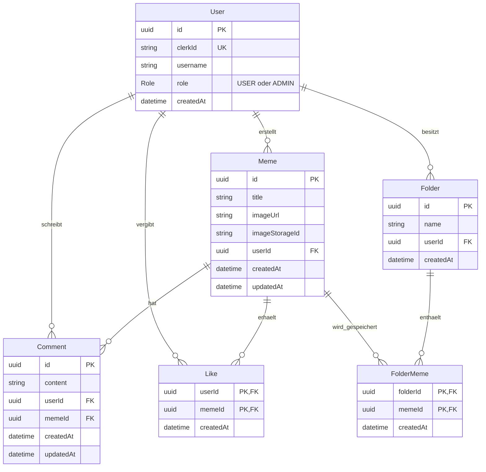

# Your Meme – Datenmodell

Planungsgrundlage für das Backend. Dieses Dokument beschreibt das Datenmodell;
ein Prisma-Schema und Datenbankmigrationen werden im nächsten Umsetzungsschritt erstellt.

## Technische Grundlage

- Node.js, Express und TypeScript
- PostgreSQL mit Prisma
- Clerk für Registrierung, Anmeldung und Passwortverwaltung
- Dauerhafter Bildspeicher: Anbieter noch offen
- Hosting: optional; Anbieter noch offen

## Beziehungsdiagramm

`PK` bezeichnet einen Primärschlüssel, `FK` einen Fremdschlüssel und `UK` einen eindeutigen Wert.
`||--o{` bedeutet: Ein Datensatz links kann mit null bis vielen Datensätzen rechts verbunden sein;
jeder Datensatz rechts gehört genau einem Datensatz links.

## Bedeutung der Modelle

- **User:** lokales Nutzerprofil mit Verknüpfung zum Clerk-Konto und Anwendungsrolle.
- **Meme:** Titel, Bildadresse, Kennung der Bilddatei beim Speicherdienst und Ersteller.
- **Comment:** Kommentartext mit Verweis auf Verfasser und Meme.
- **Like:** Zuordnung eines Nutzers zu einem gelikten Meme.
- **Folder:** persönlicher Ordner eines Nutzers.
- **FolderMeme:** Zuordnung eines Memes zu einem Ordner; die Bilddatei wird nicht kopiert.

## Eindeutigkeit und Standardwerte

- `User.clerkId` ist eindeutig; Passwörter werden ausschließlich von Clerk verwaltet.
- `User.username` ist ein öffentlicher Anzeigename und in diesem Entwurf nicht eindeutig.
- Die Standardrolle neuer Nutzer ist `USER`; `ADMIN` wird ausschließlich über einen vertrauenswürdigen serverseitigen Prozess vergeben.
- Eigenständige IDs von User, Meme, Comment und Folder werden als UUIDs automatisch erzeugt.
- Like hat einen zusammengesetzten Primärschlüssel aus `userId` und `memeId`.
- FolderMeme hat einen zusammengesetzten Primärschlüssel aus `folderId` und `memeId`.
- Dadurch kann ein Nutzer ein Meme höchstens einmal liken und ein Meme höchstens einmal pro Ordner speichern.
- Ein Meme kann gleichzeitig in mehreren Ordnern gespeichert sein.
- `createdAt` wird automatisch gesetzt; `updatedAt` bei Änderungen automatisch aktualisiert.

## Berechtigungen

| Aktion                                       | Besucher | Angemeldete Nutzer | Administratoren |
| -------------------------------------------- | -------- | ------------------ | --------------- |
| Memes ansehen und Links teilen               | Ja       | Ja                 | Ja              |
| Memes hochladen                              | Nein     | Ja                 | Ja              |
| Eigene Memes bearbeiten und löschen          | Nein     | Ja                 | Ja              |
| Fremde Memes löschen                         | Nein     | Nein               | Ja              |
| Memes liken und eigene Likes entfernen       | Nein     | Ja                 | Ja              |
| Kommentare schreiben                         | Nein     | Ja                 | Ja              |
| Eigene Kommentare bearbeiten und löschen     | Nein     | Ja                 | Ja              |
| Fremde Kommentare löschen                    | Nein     | Nein               | Ja              |
| Eigene Ordner erstellen und verwalten        | Nein     | Ja                 | Ja              |
| Auf fremde persönliche Ordner zugreifen      | Nein     | Nein               | Nein            |
| Eigenes Nutzerkonto nach Bestätigung löschen | Nein     | Ja                 | Ja              |

- Das Backend prüft bei geschützten Anfragen die Clerk-Identität.
- Die lokale Nutzerzuordnung erfolgt anhand der verifizierten Clerk-ID.
- Eigentümer- und Administratorrechte werden vor Änderungen serverseitig geprüft.
- Fremde Memes und Kommentare dürfen von Administratoren gelöscht, aber nicht bearbeitet werden.
- Das Backend übernimmt die Identität und Rolle nicht ungeprüft aus dem Request-Body.

## Löschregeln

- Meme löschen: zugehörige Kommentare, Likes und FolderMeme-Einträge entfernen.
- Die Bilddatei zusätzlich beim Bildspeicherdienst löschen; Datenbankregeln allein entfernen keine externen Dateien.
- Ordner löschen: zugehörige FolderMeme-Einträge entfernen; die ursprünglichen Memes bleiben erhalten.
- Meme aus einem Ordner entfernen: ausschließlich die betreffende FolderMeme-Zuordnung löschen.
- Kommentar oder Like löschen: ausschließlich den jeweiligen Eintrag entfernen.
- Nutzerkonto löschen: nach ausdrücklicher Bestätigung das eigene Konto und die unten aufgeführten Daten dauerhaft löschen.

### Nutzerkonto dauerhaft löschen

- Alle vom Nutzer hochgeladenen Memes einschließlich ihrer Bilddateien beim Bildspeicherdienst löschen.
- Alle zu diesen Memes gehörenden Kommentare, Likes und Ordnerzuordnungen entfernen, auch wenn sie von anderen Nutzern stammen.
- Die gelöschten Memes verschwinden dadurch auch aus den Sammlungen anderer Nutzer; deren Ordner bleiben bestehen.
- Alle Kommentare des Nutzers entfernen, auch unter Memes anderer Nutzer.
- Alle Likes des Nutzers entfernen, auch auf Memes anderer Nutzer.
- Alle persönlichen Ordner des Nutzers einschließlich ihrer FolderMeme-Zuordnungen löschen.
- Memes anderer Nutzer bleiben erhalten, wenn lediglich eine Speicherung in einem persönlichen Ordner entfernt wird.
- Das lokale User-Profil einschließlich Name beziehungsweise Benutzername, Clerk-ID und Rolle löschen.
- Das zugehörige Clerk-Konto löschen und den Login-Zustand beenden.
- Eine Wiederherstellung über die Anwendung ist nicht vorgesehen.

### Frontend-Anforderung für Dilek: Bestätigungsfenster

- Vor der Kontolöschung ein großes, deutlich sichtbares modales Warnfenster öffnen.
- Titel: **„Konto dauerhaft löschen?“**
- Vorgeschlagener Text:

  > Dein Konto und deine bei Your Meme gespeicherten Profildaten, hochgeladenen Memes,
  > Kommentare, Likes und persönlichen Ordner werden dauerhaft gelöscht. Deine Memes
  > verschwinden auch aus den Ordnern anderer Nutzer. Kommentare und Likes unter deinen
  > Memes werden ebenfalls entfernt. Dein Anmeldekonto wird bei Clerk gelöscht.
  > Diese Aktion kann nicht rückgängig gemacht werden.

- Eine zunächst nicht ausgewählte Checkbox anzeigen:
  **„Ich verstehe, dass mein Konto und die genannten Daten dauerhaft gelöscht werden.“**
- Schaltflächen: **„Abbrechen“** und **„Konto dauerhaft löschen“**.
- Die Löschschaltfläche erst nach Auswahl der Checkbox aktivieren und deutlich als destruktive Aktion kennzeichnen.
- Abbrechen, Schließen oder Escape löst keine Löschung aus.
- Den Fokus zunächst auf „Abbrechen“ setzen; der Dialog muss per Tastatur bedienbar und für Screenreader beschriftet sein.
- Während der Verarbeitung einen Fortschrittszustand anzeigen und wiederholtes Absenden verhindern.
- Erst nach bestätigtem Abschluss Erfolg anzeigen und auf die öffentliche Startseite wechseln.
- Bei Fehlern oder noch laufender Bereinigung den tatsächlichen Zustand verständlich anzeigen; keine erfolgreiche vollständige Löschung behaupten.

### Backend-Anforderungen für die Kontolöschung

- Nur das eigene Konto anhand der verifizierten Clerk-Identität löschen; keine beliebige Nutzer-ID aus dem Request übernehmen.
- Die ausdrückliche Bestätigung zusätzlich im Request prüfen; eine deaktivierte Frontend-Schaltfläche allein genügt nicht.
- Die Löschung der Datenbankeinträge als zusammenhängende Transaktion planen.
- PostgreSQL, Clerk und Bildspeicher können nicht gemeinsam durch eine einzelne Datenbanktransaktion zurückgerollt werden.
- Die Löschung deshalb als wiederholbaren Ablauf planen: betroffene Bildkennungen und Clerk-ID vorab für die Bereinigung sichern, Konto währenddessen für weitere Änderungen sperren und fehlgeschlagene Teilschritte erneut ausführen.
- Benötigte Bereinigungsdaten nur bis zum Abschluss aufbewahren und anschließend entfernen.
- Auch eine außerhalb der Anwendung ausgelöste Clerk-Kontolöschung muss den lokalen Bereinigungsablauf anstoßen können; die konkrete Anbindung wird bei der Clerk-Integration festgelegt.
- Vor Veröffentlichung Löschfristen für Backups und technische Logs separat festlegen; sie werden durch das Entfernen der aktiven Datensätze nicht automatisch bereinigt.

## Nächste Schritte

1. Datenbeziehungen in kleinen Beispielen nachvollziehen und API-Datenformate mit Dilek abstimmen.
2. Im bereits vorhandenen Backend-Ordner ein ausführbares Node.js-/Express-Projekt mit TypeScript einrichten.
3. PostgreSQL-Verbindung und Prisma einrichten; dieses Modell in `schema.prisma` übersetzen.
4. Erste Migration erstellen und Meme-Abfragen mit Postman testen.
5. Clerk, Zugriffsprüfungen und weitere Funktionen schrittweise ergänzen.
6. Vor dem Upload den Bildspeicher auswählen. Nur bei gewünschter Veröffentlichung Hosting auswählen und frühzeitig testen.

Validierung, Rechteprüfung, Tests und Dokumentation werden bei jeder Funktion mitgeführt.
Aktueller Stand und Trello-Arbeitsweise: [projektstand.md](projektstand.md).

Projektzeitraum: 27.10.2026 bis 23.11.2026. Der Code wird vom Nutzer selbst geschrieben;
dieses Dokument dient als gemeinsame Planungsgrundlage.
