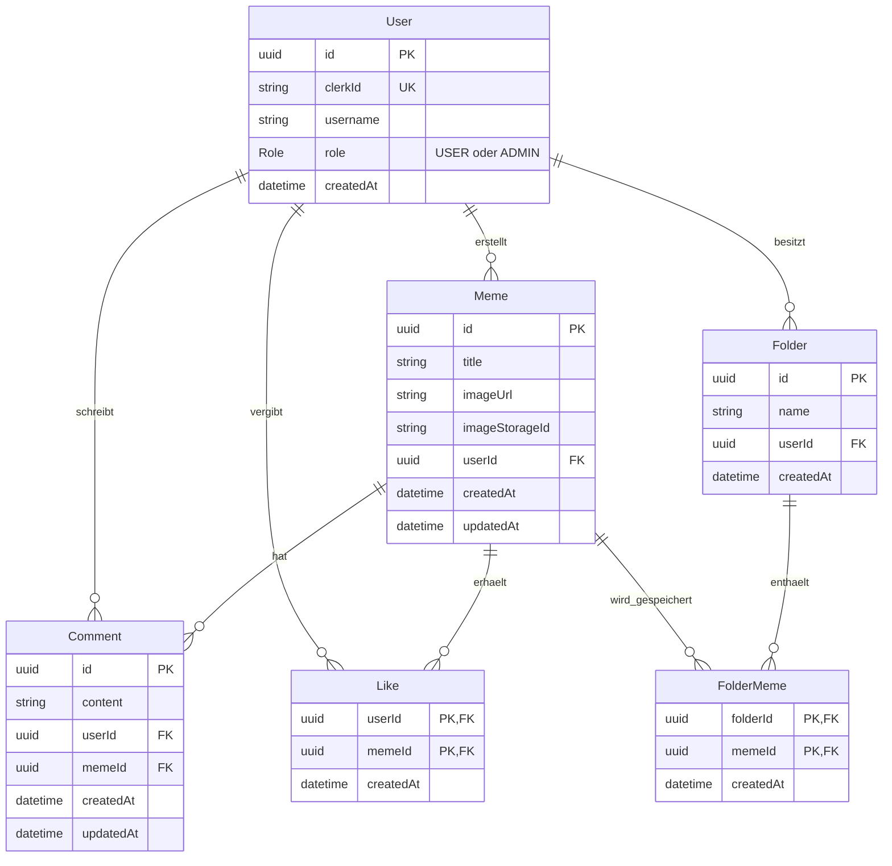

# Your Meme – Datenmodell

Planungsgrundlage für das Backend. Dieses Dokument beschreibt das Datenmodell;
ein Prisma-Schema und Datenbankmigrationen werden im nächsten Umsetzungsschritt erstellt.

## Technische Grundlage

- Node.js, Express und TypeScript
- PostgreSQL mit Prisma
- Clerk für Registrierung, Anmeldung und Passwortverwaltung
- Dauerhafter Bildspeicher: Anbieter noch offen
- Hosting: Anbieter noch offen

## Beziehungsdiagramm

`PK` bezeichnet einen Primärschlüssel, `FK` einen Fremdschlüssel und `UK` einen eindeutigen Wert.
`||--o{` bedeutet: Ein Datensatz links kann mit null bis vielen Datensätzen rechts verbunden sein;
jeder Datensatz rechts gehört genau einem Datensatz links.

## Bedeutung der Modelle

- **User:** lokales Nutzerprofil mit Verknüpfung zum Clerk-Konto und Anwendungsrolle.
- **Meme:** Titel, Bildadresse, Kennung der Bilddatei beim Speicherdienst und Ersteller.
- **Comment:** Kommentartext mit Verweis auf Verfasser und Meme.
- **Like:** Zuordnung eines Nutzers zu einem gelikten Meme.
- **Folder:** persönlicher Ordner eines Nutzers.
- **FolderMeme:** Zuordnung eines Memes zu einem Ordner; die Bilddatei wird nicht kopiert.

## Eindeutigkeit und Standardwerte

- `User.clerkId` ist eindeutig; Passwörter werden ausschließlich von Clerk verwaltet.
- `User.username` ist ein öffentlicher Anzeigename und in diesem Entwurf nicht eindeutig.
- Die Standardrolle neuer Nutzer ist `USER`; `ADMIN` wird ausschließlich über einen vertrauenswürdigen serverseitigen Prozess vergeben.
- Eigenständige IDs von User, Meme, Comment und Folder werden als UUIDs automatisch erzeugt.
- Like hat einen zusammengesetzten Primärschlüssel aus `userId` und `memeId`.
- FolderMeme hat einen zusammengesetzten Primärschlüssel aus `folderId` und `memeId`.
- Dadurch kann ein Nutzer ein Meme höchstens einmal liken und ein Meme höchstens einmal pro Ordner speichern.
- Ein Meme kann gleichzeitig in mehreren Ordnern gespeichert sein.
- `createdAt` wird automatisch gesetzt; `updatedAt` bei Änderungen automatisch aktualisiert.

## Berechtigungen

| Aktion | Besucher | Angemeldete Nutzer | Administratoren |
| --- | --- | --- | --- |
| Memes ansehen und Links teilen | Ja | Ja | Ja |
| Memes hochladen | Nein | Ja | Ja |
| Eigene Memes bearbeiten und löschen | Nein | Ja | Ja |
| Fremde Memes löschen | Nein | Nein | Ja |
| Memes liken und eigene Likes entfernen | Nein | Ja | Ja |
| Kommentare schreiben | Nein | Ja | Ja |
| Eigene Kommentare bearbeiten und löschen | Nein | Ja | Ja |
| Fremde Kommentare löschen | Nein | Nein | Ja |
| Eigene Ordner erstellen und verwalten | Nein | Ja | Ja |
| Auf fremde persönliche Ordner zugreifen | Nein | Nein | Nein |

- Das Backend prüft bei geschützten Anfragen die Clerk-Identität.
- Die lokale Nutzerzuordnung erfolgt anhand der verifizierten Clerk-ID.
- Eigentümer- und Administratorrechte werden vor Änderungen serverseitig geprüft.
- Fremde Memes und Kommentare dürfen von Administratoren gelöscht, aber nicht bearbeitet werden.
- Das Backend übernimmt die Identität und Rolle nicht ungeprüft aus dem Request-Body.

## Löschregeln

- Meme löschen: zugehörige Kommentare, Likes und FolderMeme-Einträge entfernen.
- Die Bilddatei zusätzlich beim Bildspeicherdienst löschen; Datenbankregeln allein entfernen keine externen Dateien.
- Ordner löschen: zugehörige FolderMeme-Einträge entfernen; die ursprünglichen Memes bleiben erhalten.
- Meme aus einem Ordner entfernen: ausschließlich die betreffende FolderMeme-Zuordnung löschen.
- Kommentar oder Like löschen: ausschließlich den jeweiligen Eintrag entfernen.
- Nutzerkonten löschen: Verhalten noch festzulegen; bisher keine automatische Löschung eigener Inhalte vereinbart.

## Nächste Schritte

1. API-Endpunkte, Anfrage- und Antwortformate mit der Frontend-Person abstimmen.
2. Einen eigenen Backend-Ordner mit Node.js, Express und TypeScript einrichten.
3. PostgreSQL-Verbindung und Prisma einrichten; dieses Modell in `schema.prisma` übersetzen.
4. Erste Migration erstellen und Meme-Abfragen mit Postman testen.
5. Clerk, Zugriffsprüfungen und weitere Funktionen schrittweise ergänzen.
6. Bildspeicher und Hosting auswählen und die Veröffentlichung frühzeitig testen.

Projektzeitraum: 29.10.2026 bis 23.11.2026. Der Code wird vom Nutzer selbst geschrieben;
dieses Dokument dient als gemeinsame Planungsgrundlage.
